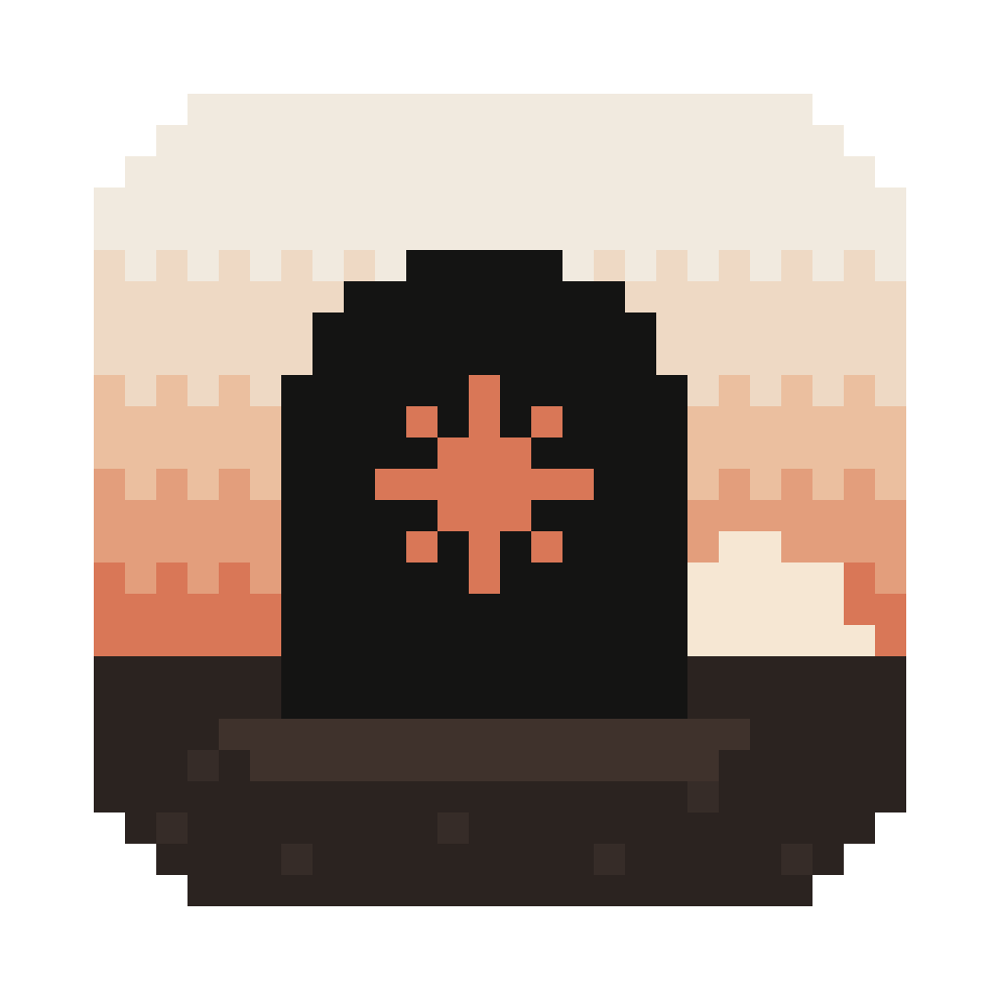

<p align="center"></p>

# Клодбище

Пиксельное кладбище для твоих заброшенных вайбкодерских проектов. Приложение само находит проекты в истории Claude Code, и если к проекту не прикасались 30 дней, хоронит его: ставит надгробие с датами жизни и человеческим именем. А крабики тем временем доедают токены.

## Установка

Открой Терминал (⌘ + пробел → «Терминал»), вставь строчку и нажми Enter:

```bash
curl -fsSL https://raw.githubusercontent.com/kovalenkonstan-cmd/klodbishche/main/install.sh | bash
```

Или просто скажи своему Claude Code: «Установи мне Клодбище: https://github.com/kovalenkonstan-cmd/klodbishche». Он сам всё сделает.

Скрипт скачает приложение, положит его в «Программы» и запустит. Той же командой Клодбище обновляется до новой версии.

Нужен macOS 11 или новее. Подходит и для Маков на M-чипах, и для Маков на Intel.

## Как пользоваться

- Кладбище появится в правом верхнем углу экрана.
- Клик по чёрному надгробию со звёздочкой сворачивает кладбище в одно надгробие и разворачивает обратно. Надгробие можно перетащить в любое место.
- Клик по камню открывает форму: там можно переименовать проект, написать эпитафию и указать причину смерти. Если это вообще не проект, его можно убрать.
- «+» хоронит проект вручную.
- Клик по земле, где гуляют крабики, подкидывает им еды.
- Меню 🪦 в строке меню сверху: добавить папку с проектами, вернуть скрытые проекты, запускать при входе, выйти.

## Откуда берутся проекты и имена

Клодбище читает историю Claude Code у тебя на компьютере (папку `~/.claude`) и смотрит, в каких папках ты работал и когда. Если какой-то проект не нашёлся, добавь папку, где лежат твои проекты, через 🪦 → «Добавить папку с проектами».

Человеческие имена проектам придумывает твой же Claude Code. Для этого он должен быть установлен и залогинен в Терминале (команда `claude`). Если его нет, на надгробиях будут имена папок, их можно поменять вручную.

## Приватность

Всё хранится только у тебя на Маке. Чтобы придумать имя, приложение отправляет короткие выдержки о проекте (заметки и первые сообщения из переписки) в твой собственный Claude Code. Больше никуда ничего не уходит.

## Как удалить

Выйди через 🪦 → «Выйти», удали **Клодбище** из «Программ» и папку `~/Library/Application Support/Клодбище`.

## Для разработчиков

```bash
npm install
npm start          # запустить из исходников
npm run dist       # собрать DMG в dist/
```

Сборка не подписана у Apple, только самоподписью (ad-hoc). Поэтому скачанный через браузер DMG macOS блокирует, а установка командой выше работает без этого.

Шрифт [Tiny5](https://fonts.google.com/specimen/Tiny5) распространяется по лицензии SIL Open Font License, текст лежит в `src/fonts/LICENSE`.
